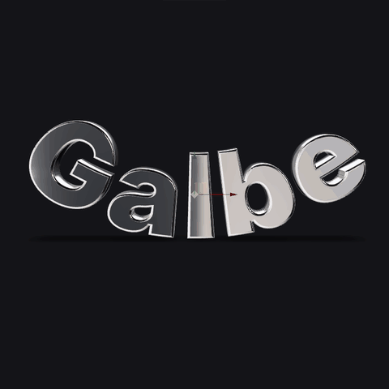

<div align="center">

# Galbe

**An open-source 3D design studio in your browser, made for graphic designers and art directors.**

3D type, extruded logos, objects, social key visuals, motion and interactive embeds —
without writing code, without installing anything, without an account.



</div>

> **Status: v0.3 — early preview.** Type, Shape (SVG), primitives, 3D objects, materials,
> lighting, post-processing effects, **motion (timeline, keyframes, presets, camera moves)**,
> the **Cover** tool (gradients, image and video backgrounds, text overlays), video export and
> local projects work today. 3D export, embeds and templates are on the
> [roadmap](./ROADMAP.md).


## Why Galbe

- **Made for designers.** Precise sliders (Shift for fine steps, Alt for coarse, type
  `*2` or `+10`), keyboard shortcuts, drag & drop, an artboard that is exactly what you
  export.
- **Real 3D typography.** Any font — 16 bundled families, the whole Google Fonts library,
  or your own `.ttf/.otf/.woff` — with kerning, ligatures, bevels and bend, twist and wave
  deformations.
- **Logos in one paste.** Copy a logo as SVG in Figma or Illustrator and paste it into
  Galbe: every path is extruded, with holes, strokes and one material per colour.
- **Objects and primitives.** Drop a GLB, GLTF, FBX or OBJ, or add a sphere, torus,
  rounded box, ring or noise blob — then restyle it with any material.
- **Motion without a manual.** Spin, float, swing, a wave through the letters, letter-by-letter
  reveals, material transitions and camera orbits in one click — or turn on **Auto-key**
  and every value you touch becomes a keyframe: positions, colours, materials, lights,
  effects, overlays.
- **Covers and key visuals.** Linear, radial and mesh gradients, image or video
  backgrounds, flat text overlays for titles and captions, safe zones and grids for social
  formats.
- **A real look stack.** Bloom, depth of field, LUTs, grain, halftone, dithering, ASCII,
  glitch… reorderable, live in the viewport and identical in exports.
- **Physically based look.** Chrome, glass with refraction and dispersion, gold, ceramic,
  pearl, holographic foil, matcaps, PBR texture sets… lit by studio and outdoor HDRIs (up to
  4K) and extra lights, with soft contact shadows and a reflective floor.
- **Print- and post-ready output.** PNG, JPG or WebP up to 8K with a transparent background,
  rendered in tiles so it works on any graphics card; MP4 (H.264), WebM (VP9, with
  transparency) or PNG sequences rendered frame by frame, identical on every machine.
- **Yours, locally.** No backend: projects autosave in your browser and travel as `.galbe`
  files (scene + fonts + images in one zip). No telemetry.
- **Open and hackable.** MIT licence, a documented scene format, and small registries for
  materials, effects, templates and AI providers.

## Quickstart

### Use it

Open the hosted studio (Cloudflare Pages, once the repository's deployment is configured)
or run it locally:

```bash
git clone https://github.com/Pauldelacv/Galbe.git
```

```bash
cd Galbe && corepack enable && pnpm install
```

```bash
pnpm dev
```

Then open <http://localhost:5173>. Requirements: Node ≥ 22.12 and a browser with WebGL 2.
Galbe is developed and tested in Chromium (Chrome, Edge, Arc…); Firefox and Safari should
work but are not tested yet. Video export uses WebCodecs.

### First minute

1. Press **T** to add text and type in the inspector on the right.
2. Pick a font (**Built-in** or **Google Fonts**) and a material preset.
3. In **Scene**, choose a format (1:1, 4:5, 9:16, 16:9, A4), a background and an HDRI.
4. Turn on **Bend**, **Twist** or **Wave** under _Deform_.
5. Paste an SVG logo (**Ctrl/⌘ V**), or add a **Primitive** or an **Object** from the left
   panel. Select several layers and press **Ctrl/⌘ G** to group them.
6. Open **Effects** in the inspector and add **Bloom**, **Film grain** or a **LUT**.
7. Select a layer and pick a preset under **Motion** (Spin, Float, Reveal…). Press **L** for
   the timeline and **Space** to play. Turn on **Auto-key** (**K**), move the playhead and
   change any value to keyframe it.
8. Click **Cover** for a gradient, image or video background and text overlays.
9. Press **Ctrl/⌘ E** to export an image or the animation as a video. Press **?** for every
   shortcut.

Drop a `.galbe`, an SVG, a 3D model, a font, an `.hdr`, images or a zipped PBR texture set,
a video (background, or a video texture on the selected layer) or a `.cube` LUT anywhere on
the window to import it.

## What's inside (v0.3)

|               |                                                                                                                                                                                                                                       |
| ------------- | ------------------------------------------------------------------------------------------------------------------------------------------------------------------------------------------------------------------------------------- |
| **Type**      | Multi-line 3D text, any font, size, alignment, letter spacing, line height, extrusion, bevel (size, depth, segments), bend (arc/wrap), twist, wave                                                                                    |
| **Shape**     | SVG import or paste, holes (non-zero / even-odd), strokes, per-path materials and visibility, layer gap, extrusion, bevel, deformations                                                                                               |
| **Objects**   | 8 parametric primitives (sphere, rounded box, torus, capsule, cylinder, cone, ring, noise blob); GLB / GLTF / FBX / OBJ import with fit size, pivot and material override                                                             |
| **Materials** | 14 original presets + every physical parameter, 8 original matcaps (+ import), holographic layer, PBR textures (colour, normal, roughness, metalness, AO, emission, opacity) with UV controls, your own material library              |
| **Effects**   | Bloom, depth of field, colour adjust, LUT (.cube + 6 looks), chromatic aberration, vignette, film grain, halftone, dithering, pixelate, ASCII, glitch — reorderable                                                                   |
| **Lighting**  | 7 CC0 HDRIs (1K bundled, 2K/4K on demand) + `.hdr` import, directional / point / spot lights, contact shadows, reflective floor, tone mapping, exposure, focal length                                                                 |
| **Motion**    | Timeline (duration, 24–60 fps, loop), keyframes on any number or colour with 12 easings, auto-key, motion presets (spin, float, swing, per-letter wave and reveal, material transition), camera orbit / truck / dolly, video textures |
| **Cover**     | Linear, radial and mesh gradients (6 presets), image and video backgrounds (cover / contain / stretch), 2D text overlays (any font, animatable), safe zones, rule of thirds, golden ratio and column grids                            |
| **Formats**   | 1:1, 4:5, 9:16, 16:9, A4 @300 dpi, custom                                                                                                                                                                                             |
| **Export**    | PNG / JPG / WebP, 1× to 8×, up to 8192 px, transparent background; MP4 (H.264), WebM (VP9, alpha), PNG sequence — frame-accurate                                                                                                      |
| **Projects**  | IndexedDB autosave with thumbnails, project list, `.galbe` save/open, undo/redo with a history panel, groups                                                                                                                          |

## Project layout

```
apps/studio          Vite + React + React Three Fiber studio
packages/core        Versioned scene schema (Zod), migrations, ops, .galbe format
packages/engine      Framework-free three.js runtime shared by studio, exports and player
packages/exporters   Image and video export (GLB/USDZ next)
packages/assets      Bundled OFL fonts, CC0 HDRIs and matcaps
```

Read [ARCHITECTURE.md](./ARCHITECTURE.md) for the scene document, the rendering pipeline
and how the pieces fit together.

## Development

```bash
pnpm dev          # studio with hot reload
```

```bash
pnpm lint && pnpm typecheck && pnpm test
```

```bash
pnpm test:e2e     # Playwright end-to-end tests (builds and serves the studio)
```

See [CONTRIBUTING.md](./CONTRIBUTING.md) to add a material, an effect, a template or an AI
provider.

## Privacy

Galbe runs entirely in your browser. It only contacts the network to load the studio
itself, the Google Fonts catalogue and the font files you pick from it (via Fontsource /
jsDelivr), and the 2K/4K environments you choose (from Poly Haven).

## Credits & licence

Galbe is released under the [MIT licence](./LICENSE). Bundled fonts are under the SIL Open
Font License, HDRIs are CC0 from [Poly Haven](https://polyhaven.com) and matcaps are rendered
from them (CC0); every file and its source is listed in [ASSETS.md](./ASSETS.md).

Galbe is an independent project. It re-implements a category of tools for 3D graphic
design; it does not reuse code, assets, templates or designs from any other product.
