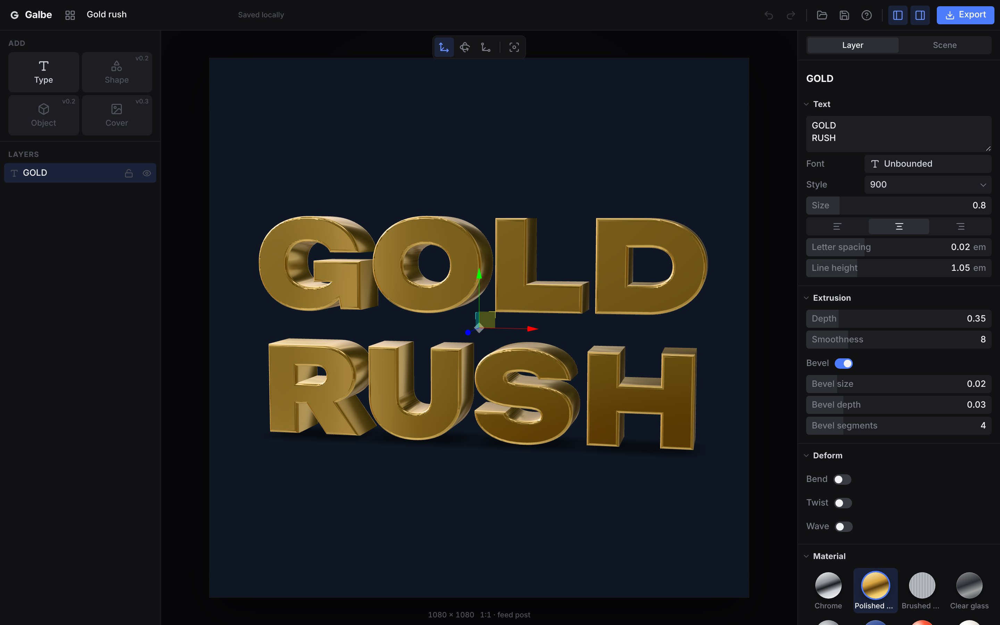
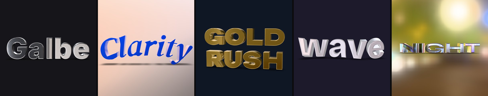

<div align="center">

# Galbe

**An open-source 3D design studio in your browser, made for graphic designers and art directors.**

3D type, extruded logos, objects, social key visuals, motion and interactive embeds —
without writing code, without installing anything, without an account.


</div>

> **Status: v0.1 — early preview.** The Type tool, materials, lighting, local projects and
> high-resolution image export work today. Shape, Object, effects, motion, embeds and
> templates are on the [roadmap](./ROADMAP.md).





## Why Galbe

- **Made for designers.** Precise sliders (Shift for fine steps, Alt for coarse, type
  `*2` or `+10`), keyboard shortcuts, drag & drop, an artboard that is exactly what you
  export.
- **Real 3D typography.** Any font — 16 bundled families, the whole Google Fonts library,
  or your own `.ttf/.otf/.woff` — with kerning, ligatures, bevels and bend, twist and wave
  deformations.
- **Physically based look.** Chrome, glass with refraction and dispersion, gold, ceramic,
  pearl… lit by studio and outdoor HDRIs, with soft contact shadows.
- **Print-ready output.** PNG, JPG or WebP up to 8K with a transparent background, rendered
  in tiles so it works on any graphics card.
- **Yours, locally.** No backend: projects autosave in your browser and travel as `.galbe`
  files (scene + fonts + images in one zip). No telemetry.
- **Open and hackable.** MIT licence, a documented scene format, and small registries for
  materials, effects, templates and AI providers.

## Quickstart

### Use it

Open the hosted studio (Cloudflare Pages, once the repository's deployment is configured)
or run it locally:

```bash
git clone https://github.com/Pauldelacv/Galbe.git
```

```bash
cd Galbe && corepack enable && pnpm install
```

```bash
pnpm dev
```

Then open <http://localhost:5173>. Requirements: Node ≥ 22.12 and a browser with WebGL 2.
v0.1 is developed and tested in Chromium (Chrome, Edge, Arc…); Firefox and Safari should
work but are not tested yet.

### First minute

1. Press **T** to add text and type in the inspector on the right.
2. Pick a font (**Built-in** or **Google Fonts**) and a material preset.
3. In **Scene**, choose a format (1:1, 4:5, 9:16, 16:9, A4), a background and an HDRI.
4. Turn on **Bend**, **Twist** or **Wave** under _Deform_.
5. Press **Ctrl/⌘ E** to export. Press **?** for every shortcut.

Drop a `.galbe`, a font file or an `.hdr` anywhere on the window to import it.

## What's inside (v0.1)

|               |                                                                                                                                                                                                                                                                                               |
| ------------- | --------------------------------------------------------------------------------------------------------------------------------------------------------------------------------------------------------------------------------------------------------------------------------------------- |
| **Type**      | Multi-line 3D text, any font, size, alignment, letter spacing, line height, extrusion, bevel (size, depth, segments), bend (arc/wrap), twist, wave                                                                                                                                            |
| **Materials** | 12 original presets (chrome, polished gold, brushed steel, clear/frosted/tinted glass, glossy plastic, glazed ceramic, matte clay, soft rubber, pearlescent, neon) + colour, metalness, roughness, transmission, IOR, thickness, dispersion, clearcoat, iridescence, sheen, emission, opacity |
| **Lighting**  | 7 CC0 HDRIs + `.hdr` import, intensity, rotation, background blur, contact shadows, tone mapping, exposure, focal length                                                                                                                                                                      |
| **Formats**   | 1:1, 4:5, 9:16, 16:9, A4 @300 dpi, custom                                                                                                                                                                                                                                                     |
| **Export**    | PNG / JPG / WebP, 1× to 8×, up to 8192 px, transparent background                                                                                                                                                                                                                             |
| **Projects**  | IndexedDB autosave with thumbnails, project list, `.galbe` save/open, undo/redo                                                                                                                                                                                                               |

## Project layout

```
apps/studio          Vite + React + React Three Fiber studio
packages/core        Versioned scene schema (Zod), migrations, ops, .galbe format
packages/engine      Framework-free three.js runtime shared by studio, exports and player
packages/exporters   Image export (video, GLB/USDZ next)
packages/assets      Bundled OFL fonts and CC0 HDRIs
```

Read [ARCHITECTURE.md](./ARCHITECTURE.md) for the scene document, the rendering pipeline
and how the pieces fit together.

## Development

```bash
pnpm dev          # studio with hot reload
```

```bash
pnpm lint && pnpm typecheck && pnpm test
```

```bash
pnpm test:e2e     # Playwright smoke test (builds and serves the studio)
```

See [CONTRIBUTING.md](./CONTRIBUTING.md) to add a material, an effect, a template or an AI
provider.

## Privacy

Galbe runs entirely in your browser. It only contacts the network to load the studio
itself, the Google Fonts catalogue and the font files you pick from it (via Fontsource /
jsDelivr), and — in a later release, only if you enable it — the AI provider you configure
with your own key.

## Credits & licence

Galbe is released under the [MIT licence](./LICENSE). Bundled fonts are under the SIL Open
Font License and HDRIs are CC0 from [Poly Haven](https://polyhaven.com); every file and
its source is listed in [ASSETS.md](./ASSETS.md).

Galbe is an independent project. It re-implements a category of tools for 3D graphic
design; it does not reuse code, assets, templates or designs from any other product.
